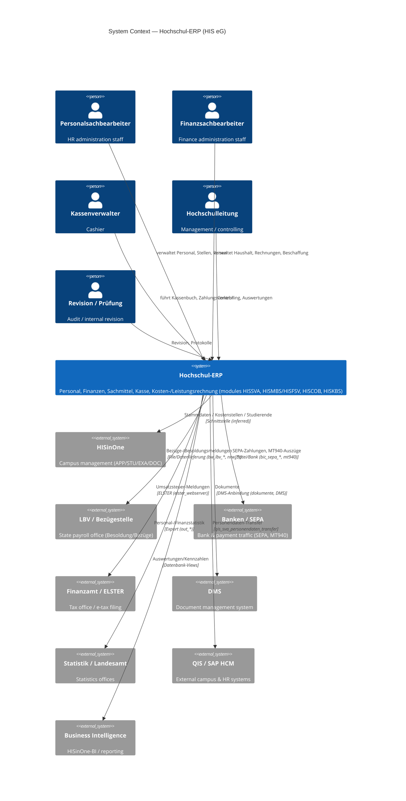

# C4 — Level 1: System Context

Scope: the **Hochschul-ERP** system (the product family the seed dump belongs
to). Everything here is reconstructed from the dump plus HIS's public product
material; the application tier is **inferred** from the database, since only the
database was provided. Inference is marked *(inferred)*.

## Diagram

## Actors

| Actor | Uses |
|---|---|
| Personalsachbearbeiter | `sva4` — personnel, positions, travel, payroll interfaces |
| Finanzsachbearbeiter | `mbs` — budget, invoices, procurement, property, inventory |
| Kassenverwalter | `kbs` — cash book, payment traffic, dunning |
| Controlling / Leitung | `cob` + reports across modules |
| Revision / Prüfung | audit/history data (`rev_*`, `*prot`, `__account_history`) |

## External systems (from evidence in the schema)

| External system | Evidence |
|---|---|
| LBV / payroll office | `sva4.bw_lbv_*`, `nrw_lbv_*`, `lbv_*` tables |
| Bank / SEPA | `mbs.bic_sepa_credit_transfer`, `bic_sepa_direct_debit`, `direct_debit_mandate`; `kbs.mt940`, `zp_bankdaten` |
| Finanzamt / ELSTER | `mbs.elster_webserver` |
| QIS | `sva4.qis_*`, `qis_sva_personendaten_transfer` |
| SAP HCM | `sva4.h1_sva_transfer`, `h1_sva_attribute_mapping` |
| DMS | `dokumente`, `__dokumente*`, `k_dokumente_*` across schemas |
| Statistics offices | `sva4.k_referenz_personalstatistik`, `out_*` exports |
| HISinOne campus | inferred; not present as tables in this dump |

## Key open point

Whether the project's "system of interest" is this **Hochschul-ERP** or the
separate **HISinOne campus** product is unresolved (see `open-questions.md` Q1).
This context diagram documents the ERP, which is what the dump contains.
