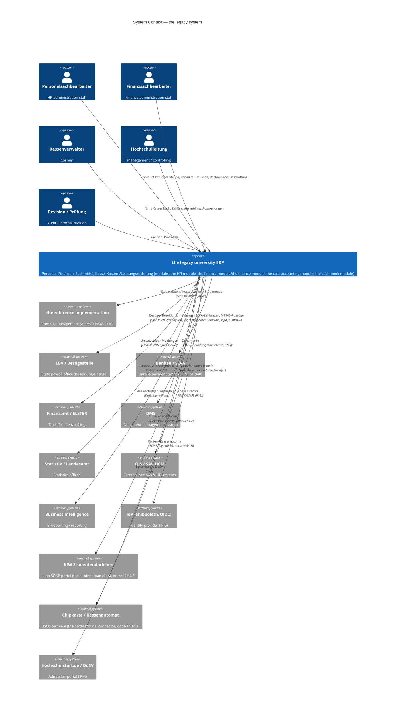

# C4 — Level 1: System Context

Scope: the **legacy university ERP** family the sample dataset belongs to.
Everything here is reconstructed from that dataset plus public product material; the application tier is **inferred** from the database, since only the
database was provided. Inference is marked *(inferred)*.

## Diagram

> For the **replacement's** external systems and each interface's
> implemented/planned status, see `05-external-systems.md`.

## Actors

| Actor | Uses |
|---|---|
| Personalsachbearbeiter | `sva4` — personnel, positions, travel, payroll interfaces |
| Finanzsachbearbeiter | `mbs` — budget, invoices, procurement, property, inventory |
| Kassenverwalter | `kbs` — cash book, payment traffic, dunning |
| Controlling / Leitung | `cob` + reports across modules |
| Revision / Prüfung | audit/history data (`rev_*`, `*prot`, `__account_history`) |

## External systems (from evidence in the schema)

| External system | Evidence |
|---|---|
| LBV / payroll office | `sva4.bw_lbv_*`, `nrw_lbv_*`, `lbv_*` tables |
| Bank / SEPA | `mbs.bic_sepa_credit_transfer`, `bic_sepa_direct_debit`, `direct_debit_mandate`; `kbs.mt940`, `zp_bankdaten` |
| Finanzamt / ELSTER | `mbs.elster_webserver` |
| QIS | `sva4.qis_*`, `qis_sva_personendaten_transfer` |
| SAP HCM | `sva4.h1_sva_transfer`, `h1_sva_attribute_mapping` |
| DMS | `dokumente`, `__dokumente*`, `k_dokumente_*` across schemas |
| Statistics offices | `sva4.k_referenz_personalstatistik`, `out_*` exports |
| the reference implementation campus | inferred; not present as tables in this dump |
| Identity provider (Shibboleth/OIDC) | `docs/14` (bundle ships an IdM connector: `UniBielefeldIdmConnectorService`) |
| KfW student loan | `the student-loan client` — a shipped Axis2 SOAP client for the KfW portal (`docs/14` §4.2) |
| Chip-card / cash terminal (BSOS) | `the card-terminal connector` (TCP bridge to `the card terminal.exe`, `docs/14` §4.1) |
| hochschulstart.de / DoSV | requirement IR-8 (admission); no tables in this dump |
| Bank (EBICS channel) | `docs/14` §4.3 — the SEPA file layer plus an EBICS transport, beyond the file tables above |

## Key open point

Whether the project's "system of interest" is this **the legacy university ERP** or the
separate **the reference implementation campus** product is unresolved (see `open-questions.md` Q1).
This context diagram documents the ERP, which is what the dump contains.
