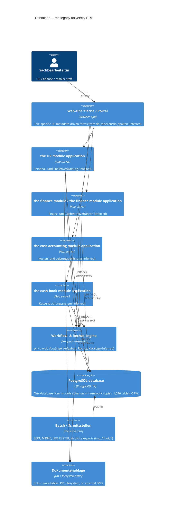
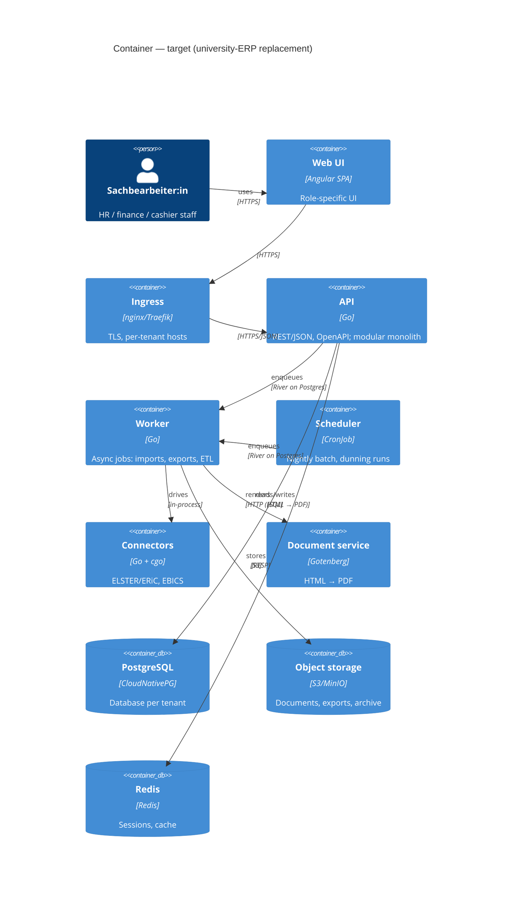

# C4 — Level 2: Container

The application tier is **inferred** from the database structure (the dump is a
database only). The database container is **measured**.

## Diagram

## Containers

| Container | Evidence / basis |
|---|---|
| Web-Oberfläche / Portal | product material ("webbasiert", "Portal", "responsive") — **[c]** |
| the HR module app | `sva4.db_version` = `the HR module-GX` — **[c]** |
| the finance module / the finance module app | `mbs.db_version` = `the finance module-UNIX` / `the finance module-GX` — **[c]** |
| the cost-accounting module app | `cob.db_version` = `the cost-accounting module-GX` — **[c]** |
| the cash-book module app | `kbs.db_version` = `the cash-book module` — **[c]** |
| Workflow & Rechte engine | framework tables `sv_*`, `wof` — **[c]** (existence), **[i]** (that it is a shared in-app engine) |
| PostgreSQL database | measured — **[c]** |
| Batch / interfaces | `imp_*`/`out_*`, SEPA/MT940/LBV tables — **[c]** |
| Document storage | `dokumente`, `k_dokumente_*`; product material names DB/filesystem/DMS options — **[c]** |

## Target containers (overview)

The replacement's containers. Descriptions are deliberately short — detail lives in
`docs/17`; the as-is model above is the legacy system.

The document path is the one new move: **API/worker render HTML → the document service
returns a PDF → the artefact goes to object storage**, and the case keeps a reference to
it (ADR-0009).

## Container-level observations

1. **One database, four module schemas, no shared schema.** Each module app owns
   its schema and carries its own framework copy (see `02-database-overview.md`
   §2). There is no central master-data schema in the dump.
2. **A separate "core" schema is minimal.** `hisrm` holds only 3 tables
   (`_customize_dumping`, `illchars_*_archived`) — it is not a shared business
   core, despite the database name.
3. **Integration is file/batch-centric** (`imp_*` staging tables, `out_*`
   exports, MT940/SEPA files) rather than a service layer, as far as the schema
   shows.
4. **The metadata layer is a container of its own in effect:** `db_tabellen`,
   `db_spalten`, `db_graph_knoten/kanten/joins` drive UI navigation dynamically —
   a significant design feature and a reverse-engineering target.
