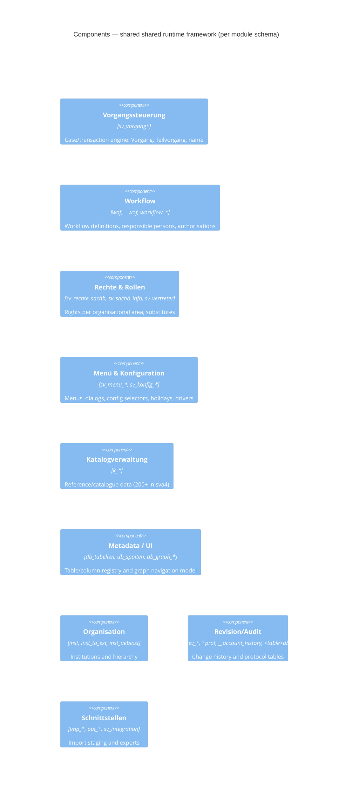

# C4 — Level 3: Component

Components are the internal building blocks of the ERP. On the evidence available
(the database), a component = a coherent cluster of tables. All application-side
grouping is **inferred** from table naming.

## Shared framework components (replicated per module schema)

## the HR module (`sva4`) — Personal- und Stellenverwaltung

| Component | Tables (representative) |
|---|---|
| Personnel case processing | `pbv`, `pbw`, `pbz`, `pbv_gehalt`, `pbv_vorzeiten`, `pbw_bewertung` |
| Personnel master data | `pgd`, `pgp`, `meta_person`, `datenannahmestelle` |
| Travel expenses (Reisekosten) | `rka_*` (14 tables) |
| Relocation / separation (Trennungsgeld) | `ter_*` |
| Benefits in kind (geldwerte Vorteile) | `gvp_*`, `ggaa` |
| Payroll interfaces | `bw_lbv_*` (30+), `nrw_*`, `lbv_*`, `h1_sva_transfer` |
| Working time & leave | `az_*`, `trg_*`, `ura`, `sdp`, `asz` |
| Social insurance | `sas*`, `sbu`, `shv`, `sko` |
| Structure & cost assignment | `bgr`, `sem*`, `sgd`, `kpt_*`, `aproj`, `aprge` |
| Payments | `import_payment*`, `calc_transaction`, `entry_transaction` |
| External integration | `qis_*`, `person_taa_config` |

## the finance module / the finance module (`mbs`) — Finanz- und Sachmittelverfahren

| Component | Tables |
|---|---|
| General ledger (FiBu) | `fibu_*` (22) |
| Budget & cost centres | `konsens_mv_*`, `zst_*`, `tit`, `titdr`, `ein_*`, `kontogen` |
| Invoice register | `rechnungseingangsbuch*`, `beleg*`, `rm*` |
| Procurement / tendering | `vergabe_*`, `anfr*`, `ange*`, `auft*`, `lieferant`, `warenannahme` |
| Property management (GLM) | `glm_*`, `geb`, `gebber`, `flur`, `gemark`, `boden`, `miete` |
| Inventory / assets | `iv*` (11) |
| Banking / SEPA | `bic_sepa_*`, `direct_debit_mandate`, `creditor_id`, `kto_auszug` |
| Projects / funding | `prg*`, `proaus`, `rpplan`, `rpvor`, `rna*` |
| Personnel cost | `pers`, `ein_personal`, `lohn_to_koa` |

## the cost-accounting module (`cob`) — Kosten- und Leistungsrechnung

| Component | Tables |
|---|---|
| Budget structure | `busa`, `arch_busa`, `imp_busa`, `alt_*` |
| Reference quantities | `bzgr`, `bzgr_empf` |
| Cost/activity lines & reports | `l100`…`l910`, `lcr*` |
| Apportionment (Umlage) | `kpum*`, `umks*`, `umvm*`, `vmpr` |
| Projects & study linkage | `proj*`, `stud`, `stug`, `stupl`, `ff_to_stug` |
| Third-party funds | `drittmittelherk`, `dta_verzvtbu`, `rna_to_nakfa` |
| Budget target (Ansatz) | `ansc`, `ansc_to_inst` |
| Evaluation / tooling | `eval*`, `reporttypen`, `tabkey*`, `trees`, `tree_cfg` |

## the cash-book module (`kbs`) — Kassenbuchungssystem

| Component | Tables |
|---|---|
| Cash book | `kass`, `schalterbuch`, `sb*`, `bu*`, `geing`, `dr*` |
| Payment orders | `ao`, `aoar`, `feao` |
| Payment traffic | `zawe*`, `zabe`, `zbu`, `zp_*`, `zv_freigabe`, `mt940*`, `mandat` |
| Cheques | `scheck`, `bln_verst_einz` |
| Dunning | `mahn*` |
| Foundations | `stift*`, `tgas`, `titkto` |
| Tax office | `finanzamt*`, `mwst_art` |
| Reconciliation | `rueck*`, `datrueck*` |
| Exports | `sos_export`, `stu_export`, `kbsans` |

## Cross-module seams

`bga_to_mbs`, `ivsexpcob`, `proj_to_inst`, `proj_to_pbv`, `proj_to_stug`,
`ansc_to_inst`, `kpt_*`, `kbsans` — the only structural hints of integration.
