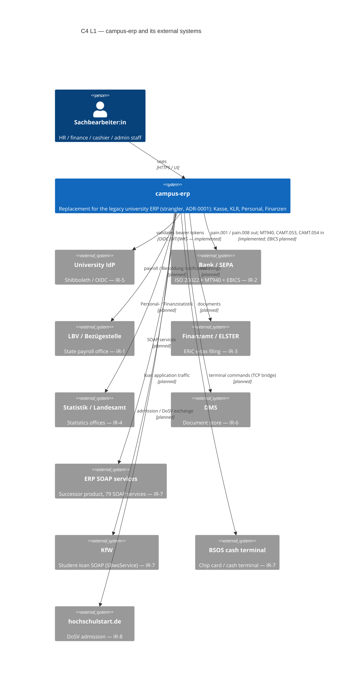

# C4 — Level 1 (companion): campus-erp and its external systems

The other C4 files reconstruct the **legacy** the legacy university ERP from its database. This
one documents the **replacement** (`campus-erp`) and, specifically, its **external
systems** — the interfaces a drop-in replacement must implement. It is grounded in
the productive-source inventory (`docs/14`), the shipped interface registry
(`internal/platform/interfaces`) and ADR-0005, not inferred from the dump.

Status per interface is the registry's own (`implemented` / `planned`); the
registry is the single source of truth and its rendered form is pinned by a test
(`backend/internal/platform/interfaces/testdata/interfaces.txt`).

## Diagram

## Interfaces (requirement → external system)

| Req | External system | Interfaces (registry keys) | Status |
|---|---|---|---|
| IR-1 | LBV / state pay office | `lbv-payoffice` (per-Bundesland file) | planned |
| IR-2 | Bank | `bank-sepa-sct`, `bank-sepa-sdd` (out); `bank-mt940`, `bank-camt052`, `bank-camt053`, `bank-camt054` (in) | implemented |
| IR-2 | Bank | `bank-ebics` (channel, both) | planned |
| IR-3 | Finanzamt | `elster-eric` (ERiC) | planned |
| IR-4 | Statistics offices | `statistics` (per-state) | planned |
| IR-5 | University IdP | `idp-oidc` (OIDC JWT/JWKS) | implemented |
| IR-6 | DMS | `dms` (own store + connector) | planned |
| IR-7 | the reference implementation | `erp-soap` (SOAP, 79 services); `einvoice-in`/`einvoice-out` (XRechnung) | SOAP planned, e-invoice implemented |
| IR-7 | KfW | `kfw-loan` (SBwsService SOAP) | planned |
| IR-7 | Cash/chip terminal | `card-terminal` (BSOS TCP bridge) | planned |
| IR-8 | hochschulstart.de | `hochschulstart` (DoSV) | planned |

## How external systems are reached (connectors, ADR-0005)

External traffic does not run inside the domain services. Each adapter lives in the
**connectors** role, so a protocol failure (a bank outage, a DB-API version change)
cannot take down the API:

- **Files** (SEPA, MT940, CAMT) are produced/parsed by the core packages
  (`internal/core/sepa`, `…/mt940`, `…/camt053`, `…/camt054`) and exchanged as
  versioned files; the transport (EBICS, SFTP) is a connector concern.
- **SOAP / device** interfaces (SOAP, KfW, BSOS) are connectors too — the bundle
  ships their clients (`the SOAP service catalogue`, `the student-loan client`, `the card-terminal connector`,
  `docs/14`).
- Every interface carries a **versioned format contract and a golden file**; the
  registry marks `implemented` only when shipped code backs it.

## Evidence

- Interface inventory: `docs/14` (SOAP SoapUI project — 79 services / 638
  operations; `the card-terminal connector`; `the student-loan client`; the ISO 20022 XSDs in
  `the reference parser`).
- Requirements: `docs/requirements.md` §5 (IR-1…IR-8).
- Status: `internal/platform/interfaces/registry.go`.
